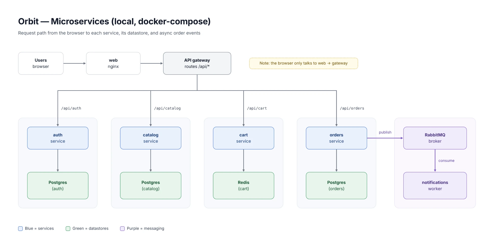
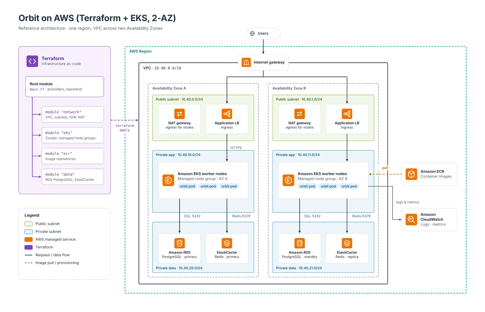
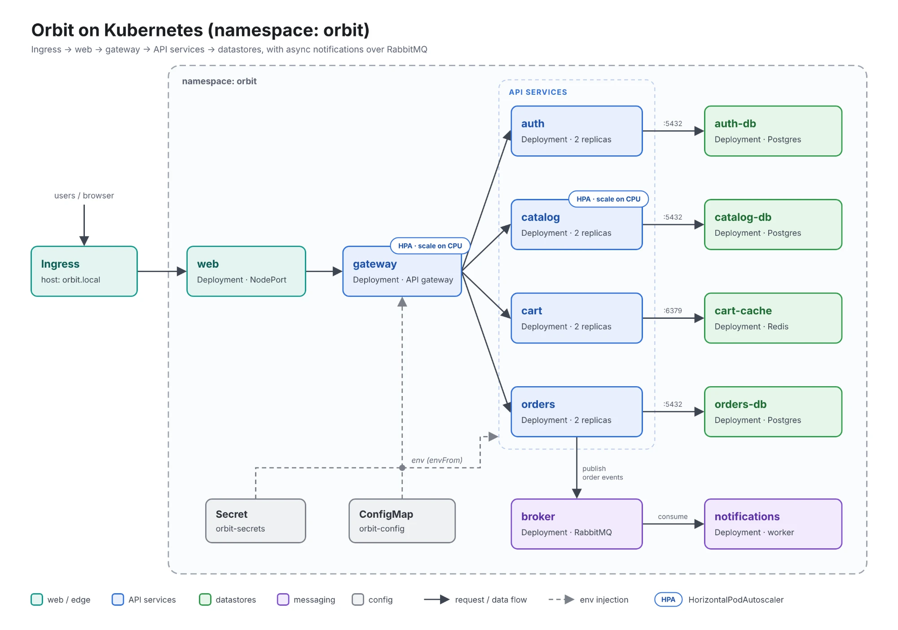

# Orbit — microservices e-commerce platform

A complete, real microservices application that ties together **microservices + Docker + docker-compose + CI/CD + Terraform (AWS) + Kubernetes**.

## Architecture
**Microservices (local, docker-compose):**


**On AWS (Terraform + EKS):**


**On Kubernetes (namespace: orbit):**


```
                         ┌──────────── gateway (edge, :8080) ────────────┐
Users → web (nginx) ───▶ │  /api/auth → auth     /api/cart → cart        │
                         │  /api/catalog → catalog  /api/orders → orders │
                         └───────────────────────────────────────────────┘
   auth ─▶ Postgres(auth)     catalog ─▶ Postgres(catalog)
   cart ─▶ Redis              orders ─▶ Postgres(orders) ─▶ RabbitMQ ─▶ notifications (worker)
```

## What's inside
- **6 microservices** (Node/Express), each its own code, `package.json`, and Dockerfile:
  - `gateway` — API gateway / reverse proxy (single entry for the frontend).
  - `auth` — register/login/JWT (Postgres + bcrypt).
  - `catalog` — products (Postgres, seeded).
  - `cart` — shopping cart (Redis, JWT-protected).
  - `orders` — place/list orders (Postgres), **publishes events to RabbitMQ**.
  - `notifications` — a worker that **consumes order events** and "sends" confirmations.
- **web** — a polished storefront UI (HTML/CSS/JS) served by nginx, talking only to the gateway.
- **Data**: 3× Postgres, Redis, RabbitMQ.
- **docker-compose.yml** — run the whole platform locally with one command.
- **.github/workflows/** — `ci.yml` (build/test every service + validate compose) and `cd.yml` (build+push images to ECR, deploy to EKS).
- **infra/terraform/** — modular AWS: **VPC + EKS + RDS (Postgres) + ElastiCache (Redis) + ECR**.
- **k8s/** — Kustomize manifests: every service + datastore as Deployments/Services, Secrets/ConfigMap, Ingress, and HPAs.

## Repo layout
```
orbit/
├── docker-compose.yml
├── .env.example
├── services/            gateway, auth, catalog, cart, orders, notifications  (code + Dockerfile)
├── web/                 storefront UI + nginx + Dockerfile
├── .github/workflows/   ci.yml, cd.yml
├── infra/terraform/     modules: network, eks, ecr, data (rds + elasticache)
└── k8s/                 kustomize: namespace, config, infra/, services/, ingress, hpa
```

---

## Run locally (Docker Compose)
```bash
cp .env.example .env
docker compose up --build        # start everything
# open http://localhost:3000
docker compose logs -f notifications   # watch order events
docker compose down              # stop (keep data)
docker compose down -v           # stop + wipe volumes
```
- Open the store at **http://localhost:3000**, register, add to cart, place an order.
- RabbitMQ console: **http://localhost:15672** (orbit / orbit).

## Deploy to AWS (Terraform)
Provision VPC + EKS + RDS (Postgres) + ElastiCache (Redis) + ECR:
```bash
cd infra/terraform
export TF_VAR_db_password='...'
terraform init
terraform plan
terraform apply
```

## Deploy to Kubernetes
Local (minikube) — build the images into the cluster, then apply:
```bash
eval $(minikube docker-env)
for s in gateway auth catalog cart orders notifications; do docker build -t orbit-$s:latest ./services/$s; done
docker build -t orbit-web:latest ./web
kubectl apply -k k8s/
kubectl get pods -n orbit -w
minikube service web -n orbit
```
On EKS, the **CD** workflow (`.github/workflows/cd.yml`) builds and pushes images to **ECR** on push to `main`, then `kubectl apply -k k8s/` and rolls out the new images.

## Notes
- Default dev secrets live in `.env.example` — change `JWT_SECRET` and passwords for anything real.
- The frontend calls only `/api/*`; nginx proxies that to the `gateway`, which routes to each service — the browser never talks to a service directly.
- Terraform validates (`terraform validate`), docker-compose validates (`docker compose config`), and the k8s manifests render with `kubectl kustomize k8s/`.
